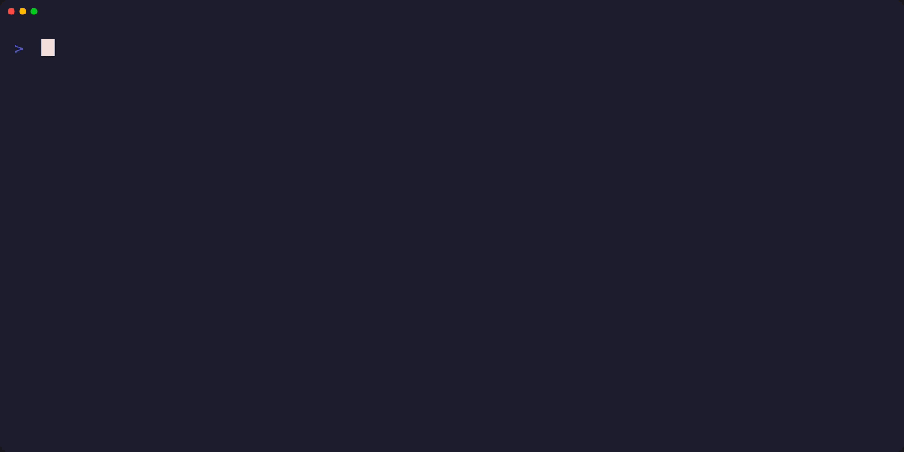
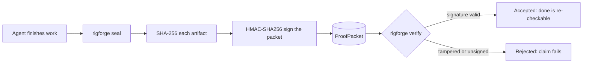

# rigforge

> Catches AI coding agents when they say work is done but it is not.



[](https://github.com/mrodgersjs-web/rigforge/actions/workflows/ci.yml)


For teams that let AI coding agents write code. An agent's "done" becomes a signed record you re-check with one command, not a message in a chat thread.

## Why this exists

AI coding agents are fast and confident, and they report success they did not earn. A "done" in a terminal cannot be audited: nothing behind it shows what ran, or that nothing changed afterwards. rigforge seals finished work into a `ProofPacket` (a signed record of what a build did): every artifact is hashed, the packet is HMAC-signed, and verification re-checks both. Tamper the result and the signature fails.

## What it proves

Every row is a command you can run yourself. Results measured 2026-10-19 on a fresh `pip install -e '.[dev]'`:

| Check | Command | Measured result |
| :-- | :-- | :-- |
| A forged "done" is caught | `rigforge demo` | exits 0; the re-forged hash passes naive integrity and fails the HMAC check |
| No forgery passes | `rigforge benchmark` | 8/8 forgeries caught, 0/8 honest claims blocked, accuracy 1.00 (16 scenarios, fixed seed) |
| Signing is what catches them | `rigforge benchmark --leaderboard` | naive integrity 0% (0/12), signed 67% (8/12), spec-bound 100% (12/12) |
| The suite passes offline | `pytest -q` | 320 passed, 0 skipped |
| Package coverage | `pytest -q --cov=rigforge --cov=contracts` | 84% (test files excluded) |
| Smoke path | `bash scripts/smoke.sh` | `rigforge smoke PASS` |

If a check cannot fail, it is theater.

## Quickstart

```bash
git clone https://github.com/mrodgersjs-web/rigforge.git && cd rigforge
python3 -m venv .venv && source .venv/bin/activate
pip install -e .
rigforge demo
```

The demo forges a `BUILD COMPLETE` claim, lets the tamper re-forge the packet hash, and shows the signature check catching the lie.

## Usage

The smallest real integration is [`examples/verify_agent_done.py`](examples/verify_agent_done.py), runnable with `python examples/verify_agent_done.py`:

```python
from rigforge.proof import ArtifactRecord, GateOutcome, ProofPacket

packet = ProofPacket(
    phase=1, name="Agent build", verifier="my-agent@example",
    evidence="Agent reported BUILD COMPLETE.",
    artifacts=[ArtifactRecord.from_path(artifact, base=base)],
    gates=[GateOutcome(name="tests", passed=True, detail="agent: 100% green")],
).sealed(signing_key=key)   # the key stays with you, never with the agent

ok = packet.verify_integrity() and packet.verify_signature(key)
```

Real output from that example:

```
honest claim   accepted: True
forged integrity ok: True
forged claim   accepted: False
```

The forged packet re-hashes a tampered artifact, so naive integrity passes and the HMAC signature fails, because the attacker has no key. The full guide (CLI reference, MCP tools for agents, spec-bound proofs, merge gate, swarm verdict board, configuration) is in [`docs/USAGE.md`](docs/USAGE.md).

## How it works



Work flows through 7 phases; each runs deterministic quality gates and, on success, seals its `ProofPacket`. Design notes: [`docs/ARCHITECTURE.md`](docs/ARCHITECTURE.md).

## Project layout

| Path | What lives there |
| :-- | :-- |
| `rigforge/` | CLI, proof layer, benchmark, gates, MCP server, cockpit web UI |
| `contracts/` | v1 contract models and YAML schemas (done contracts, acceptance criteria) |
| `examples/` | Runnable integrations; `rigforge/tests/test_examples.py` executes them |
| `docs/` | Architecture, threat model, usage guide, public boundary |
| `scripts/smoke.sh` | One-command smoke check, also run by CI |

## Development

```bash
pip install -e '.[dev]'    # the dev extra installs everything the full suite needs
pytest -q                  # 320 passed, 0 skipped (measured 2026-10-19)
ruff check .
```

CI runs the suite on Python 3.10 to 3.13 with coverage, at normal and narrow terminal widths. See [`CONTRIBUTING.md`](CONTRIBUTING.md) for the workflow. Numbers on this page come from the commands above, never from estimates.

## Public boundary

Demo keys and fixtures only. Signing keys, customer data and private fleet credentials never leave the host. What rigforge proves and what it deliberately does not: [`docs/public-boundary.md`](docs/public-boundary.md) and [`docs/THREAT_MODEL.md`](docs/THREAT_MODEL.md).

## Security

HMAC signatures are symmetric, which limits who can verify. Read [`SECURITY.md`](SECURITY.md) for the limitation, the public-attestation composition path, and how to report an issue.

## License

MIT, see [`LICENSE`](LICENSE).

---

<sub>Built by Mike Rodgers · [rodgersintelligence.com](https://rodgersintelligence.com)</sub>
